# Krushna Kale

**Python · Automation · Web Development**

I build Python tools and scripts to automate repetitive tasks. I also build web projects with JavaScript and TypeScript, and explore Linux and cybersecurity through hands-on practice.

[Portfolio](https://krushnakaale.vercel.app/) · [LinkedIn](https://www.linkedin.com/in/krushnakaale/) · [Instagram](https://www.instagram.com/krushnakaale/)

## Tech stack

**Python** / **JavaScript** / **TypeScript** / **HTML & CSS** / **Linux** / **Git** / **GitHub Actions**

## Projects and activity

<!-- DYNAMIC:START -->
**Public projects:** 11 &nbsp;·&nbsp; **Stars on projects:** 3 &nbsp;·&nbsp; **Forks of projects:** 1 &nbsp;·&nbsp; **Followers:** 2

### Recent projects

#### [Python-Projects ↗](https://github.com/krushnakaale/Python-Projects)

> Organized Python projects from beginner to advanced levels for hands-on learning and practice.

Python · Pushed 2026-11-23 UTC

#### [Python-Basic-Projects ↗](https://github.com/krushnakaale/Python-Basic-Projects)

> A collection of 30 beginner-friendly Python projects covering Python fundamentals, logic building, file handling, and basic GUI applications.

Python · ★ 1 · Pushed 2026-11-23 UTC

#### [yt-manager ↗](https://github.com/krushnakaale/yt-manager)

> A desktop app for organizing YouTube videos and playlists, previewing saved videos, and managing authorized file downloads.

JavaScript · Pushed 2026-11-22 UTC

#### [Myraa-Voice-Assistant ↗](https://github.com/krushnakaale/Myraa-Voice-Assistant)

TypeScript · ★ 1 · Pushed 2026-09-13 UTC

#### [resume ↗](https://github.com/krushnakaale/resume)

> My latest professional resume in PDF format. This repository hosts the most up-to-date version of my resume, accessible for recruiters, collaborators, and professional connections.

★ 1 · Pushed 2026-08-23 UTC

#### [fresher-party-management-system ↗](https://github.com/krushnakaale/fresher-party-management-system)

> Full-stack event management system for college fresher's parties — student registration, Razorpay payments, secure QR entry passes, and an admin dashboard with live QR scanning. Built with React, Node.js, Express, and MongoDB.

JavaScript · Pushed 2026-08-03 UTC

#### [TA0023 ↗](https://github.com/krushnakaale/TA0023)

> During medical emergencies, patients struggle to find hospitals with available beds and active OPD services. This project provides a centralized digital platform to monitor hospital bed availability and OPD status in real time.

JavaScript · Pushed 2026-02-21 UTC

#### [SevaSetu ↗](https://github.com/krushnakaale/SevaSetu)

> Full-stack healthcare platform with user authentication, doctor appointments, pharmacy services, and emergency support.

JavaScript · Pushed 2026-02-20 UTC

### Primary languages by repository

**JavaScript**: 5 · **Python**: 2 · **HTML**: 2 · **TypeScript**: 1
<!-- DYNAMIC:END -->

## Contributions

<picture>
  <source media="(prefers-color-scheme: dark)" srcset="https://raw.githubusercontent.com/krushnakaale/krushnakaale/output/github-contribution-grid-snake-dark.svg">
  <source media="(prefers-color-scheme: light)" srcset="https://raw.githubusercontent.com/krushnakaale/krushnakaale/output/github-contribution-grid-snake.svg">
  
</picture>
