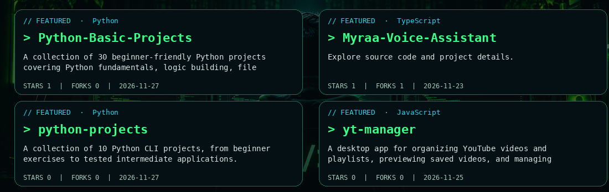
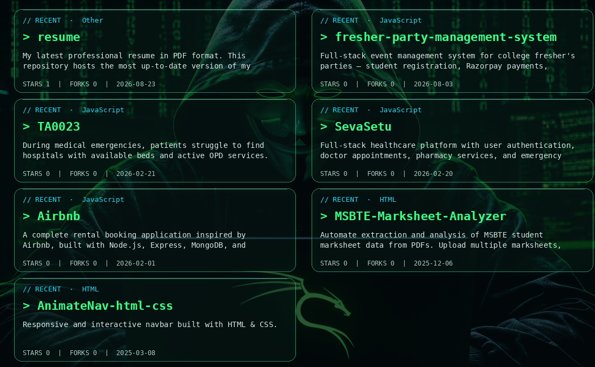
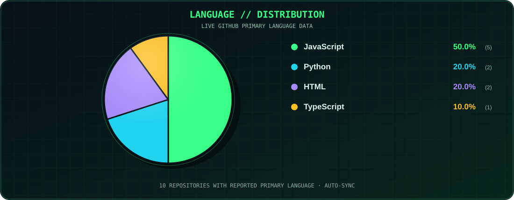
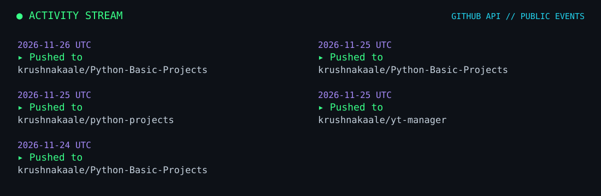

### > whoami

I build Python tools and automation scripts, develop practical web applications, and learn secure development and cybersecurity through hands-on projects. I use Linux and Git to build and document my work while learning how to contribute to open source.

[Explore my portfolio ↗](https://krushnakaale.vercel.app/)

### > current_mission

<!-- FOCUS:START -->
**`[ SYSTEM ONLINE ]  //  CURRENT MISSION`**

**◈ EXPLORING**
- `> ` Python automation
- `> ` Cybersecurity fundamentals
- `> ` Open-source development

`> learn • build • secure • repeat_`
<!-- FOCUS:END -->

## `03 // TECH STACK`

## `04 // LIVE GITHUB DASHBOARD`

*Verified public metrics, refreshed automatically by GitHub Actions.*

<!-- STATS:START -->

<!-- STATS:END -->

## `05 // FEATURED PROJECTS`

*Selected builds worth exploring · Purple spotlight cards · Live stars, forks and project details.*

<!-- FEATURED:START -->

[Python-Basic-Projects](https://github.com/krushnakaale/Python-Basic-Projects) · [Myraa-Voice-Assistant](https://github.com/krushnakaale/Myraa-Voice-Assistant) · [Python-Projects](https://github.com/krushnakaale/Python-Projects) · [yt-manager](https://github.com/krushnakaale/yt-manager)
<!-- FEATURED:END -->

## `06 // LATEST REPOSITORIES`

*Freshest public builds first · Cyan repository cards · Automatically refreshed from GitHub.*

<!-- REPOSITORIES:START -->

[Python-Projects](https://github.com/krushnakaale/Python-Projects) · [Python-Basic-Projects](https://github.com/krushnakaale/Python-Basic-Projects) · [yt-manager](https://github.com/krushnakaale/yt-manager) · [Myraa-Voice-Assistant](https://github.com/krushnakaale/Myraa-Voice-Assistant) · [resume](https://github.com/krushnakaale/resume) · [fresher-party-management-system](https://github.com/krushnakaale/fresher-party-management-system) · [TA0023](https://github.com/krushnakaale/TA0023) · [SevaSetu](https://github.com/krushnakaale/SevaSetu)

[View all repositories ↗](https://github.com/krushnakaale?tab=repositories)
<!-- REPOSITORIES:END -->

## `07 // LANGUAGE BREAKDOWN`

<!-- LANGUAGES:START -->

<!-- LANGUAGES:END -->

## `08 // PUBLIC ACTIVITY FEED`

<!-- ACTIVITY:START -->

<!-- ACTIVITY:END -->

## `09 // CONTRIBUTION SNAKE`

<picture>
  <source media="(prefers-color-scheme: dark)" srcset="https://raw.githubusercontent.com/krushnakaale/krushnakaale/output/github-contribution-grid-snake-dark.svg">
  <source media="(prefers-color-scheme: light)" srcset="https://raw.githubusercontent.com/krushnakaale/krushnakaale/output/github-contribution-grid-snake.svg">
  
</picture>

[View contribution activity on GitHub ↗](https://github.com/krushnakaale#js-contribution-activity)

## `10 // CONNECT WITH ME`

   

**Turning curiosity into code. Building tools that make an impact.**

---

PROFILE SYSTEM ONLINE · Powered by Python, GitHub API & GitHub Actions

