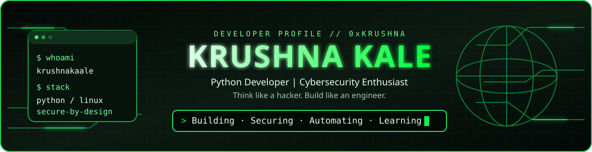

### > whoami

I build Python tools and automation scripts, develop practical web applications, and learn secure development and cybersecurity through hands-on projects. I use Linux and Git to build and document my work while learning how to contribute to open source.

[Explore my portfolio ↗](https://krushnakaale.vercel.app/)

### > current_mission

<!-- FOCUS:START -->
> **Learning interests**
> - Python automation
> - Cybersecurity fundamentals
> - Open-source development
<!-- FOCUS:END -->

## `03 // TECH STACK`

> **BUILDING • SECURING • AUTOMATING • LEARNING**

**Programming**

    

**Tools**

   

## `04 // LIVE GITHUB DASHBOARD`

*Verified public metrics, refreshed automatically by GitHub Actions.*

<!-- STATS:START -->

<!-- STATS:END -->

## `05 // FEATURED PROJECTS`

*Handpicked repositories. Project stars and metadata update automatically.*

<!-- FEATURED:START -->
<table width="100%">
<tr><td width="50%" valign="top"><a href="https://github.com/krushnakaale/Python-Basic-Projects"><strong>◈ Python-Basic-Projects</strong></a>
A collection of 30 beginner-friendly Python projects covering Python fundamentals, logic building, file handling, and basic GUI applications.
⌘ Python &nbsp;·&nbsp; ★ 1</td><td width="50%" valign="top"><a href="https://github.com/krushnakaale/Myraa-Voice-Assistant"><strong>◈ Myraa-Voice-Assistant</strong></a>
Explore the source code and project documentation.
⌘ TypeScript &nbsp;·&nbsp; ★ 1</td></tr>
<tr><td width="50%" valign="top"><a href="https://github.com/krushnakaale/Python-Projects"><strong>◈ Python-Projects</strong></a>
Organized Python projects from beginner to advanced levels for hands-on learning and practice.
⌘ Python &nbsp;·&nbsp; ★ 0</td><td width="50%" valign="top">&nbsp;</td></tr>
</table>
<!-- FEATURED:END -->

## `06 // LATEST REPOSITORIES`

*Automatically sorted by most recently pushed.*

<!-- REPOSITORIES:START -->
#### [Python-Projects ↗](https://github.com/krushnakaale/Python-Projects)

> Organized Python projects from beginner to advanced levels for hands-on learning and practice.

Python · ★ 0 · Pushed 2026-11-23 UTC

#### [Python-Basic-Projects ↗](https://github.com/krushnakaale/Python-Basic-Projects)

> A collection of 30 beginner-friendly Python projects covering Python fundamentals, logic building, file handling, and basic GUI applications.

Python · ★ 1 · Pushed 2026-11-23 UTC

#### [yt-manager ↗](https://github.com/krushnakaale/yt-manager)

> A desktop app for organizing YouTube videos and playlists, previewing saved videos, and managing authorized file downloads.

JavaScript · ★ 0 · Pushed 2026-11-22 UTC

#### [Myraa-Voice-Assistant ↗](https://github.com/krushnakaale/Myraa-Voice-Assistant)

TypeScript · ★ 1 · Pushed 2026-09-13 UTC

#### [resume ↗](https://github.com/krushnakaale/resume)

> My latest professional resume in PDF format. This repository hosts the most up-to-date version of my resume, accessible for recruiters, collaborators, and professional connections.

★ 1 · Pushed 2026-08-23 UTC

#### [fresher-party-management-system ↗](https://github.com/krushnakaale/fresher-party-management-system)

> Full-stack event management system for college fresher's parties — student registration, Razorpay payments, secure QR entry passes, and an admin dashboard with live QR scanning. Built with React, Node.js, Express, and MongoDB.

JavaScript · ★ 0 · Pushed 2026-08-03 UTC

#### [TA0023 ↗](https://github.com/krushnakaale/TA0023)

> During medical emergencies, patients struggle to find hospitals with available beds and active OPD services. This project provides a centralized digital platform to monitor hospital bed availability and OPD status in real time.

JavaScript · ★ 0 · Pushed 2026-02-21 UTC

#### [SevaSetu ↗](https://github.com/krushnakaale/SevaSetu)

> Full-stack healthcare platform with user authentication, doctor appointments, pharmacy services, and emergency support.

JavaScript · ★ 0 · Pushed 2026-02-20 UTC

[View all repositories ↗](https://github.com/krushnakaale?tab=repositories)
<!-- REPOSITORIES:END -->

## `07 // LANGUAGE BREAKDOWN`

<!-- LANGUAGES:START -->
**JavaScript** 5 · **Python** 2 · **HTML** 2 · **TypeScript** 1
<!-- LANGUAGES:END -->

Counts reflect each eligible repository’s primary language as reported by GitHub.

## `08 // PUBLIC ACTIVITY FEED`

<!-- ACTIVITY:START -->
- **2026-11-23 UTC** · Pushed to [krushnakaale/Python-Basic-Projects](https://github.com/krushnakaale/Python-Basic-Projects)
- **2026-11-22 UTC** · Created a Git ref in [krushnakaale/Python-Basic-Projects](https://github.com/krushnakaale/Python-Basic-Projects)
- **2026-11-22 UTC** · Created a Git ref in [krushnakaale/yt-manager](https://github.com/krushnakaale/yt-manager)
<!-- ACTIVITY:END -->

## `09 // CONTRIBUTION SNAKE`

<picture>
  <source media="(prefers-color-scheme: dark)" srcset="https://raw.githubusercontent.com/krushnakaale/krushnakaale/output/github-contribution-grid-snake-dark.svg">
  <source media="(prefers-color-scheme: light)" srcset="https://raw.githubusercontent.com/krushnakaale/krushnakaale/output/github-contribution-grid-snake.svg">
  
</picture>

[View contribution activity on GitHub ↗](https://github.com/krushnakaale#js-contribution-activity)

## `10 // CONNECT WITH ME`

   

---

PROFILE SYSTEM ONLINE · Powered by Python, GitHub API & GitHub Actions · Think like a hacker. Build like an engineer.

