# Krushna Kale

## About me

I build Python tools and automation scripts, develop practical web applications, and learn secure development and cybersecurity through hands-on projects. I use Linux and Git to build and document my work while learning how to contribute to open source.

[Explore my portfolio ↗](https://krushnakaale.vercel.app/)

## Current focus

<!-- FOCUS:START -->
Available after the first profile refresh.
<!-- FOCUS:END -->

## Technology stack

**Programming**

    

**Tools**

   

## GitHub dashboard

<!-- STATS:START -->

<!-- STATS:END -->

## Featured projects

<!-- FEATURED:START -->
Available after the first profile refresh.
<!-- FEATURED:END -->

## Recent repositories

<!-- REPOSITORIES:START -->
Available after the first profile refresh.
<!-- REPOSITORIES:END -->

## Primary languages

<!-- LANGUAGES:START -->
Available after the first profile refresh.
<!-- LANGUAGES:END -->

Counts reflect each eligible repository’s primary language as reported by GitHub.

## Recent public activity

<!-- ACTIVITY:START -->
Available after the first profile refresh.
<!-- ACTIVITY:END -->

## Contribution snake

[View contribution activity on GitHub ↗](https://github.com/krushnakaale#js-contribution-activity)

## Connect

   

GitHub Actions refreshes the public dashboard automatically.
