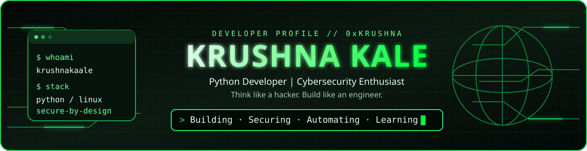
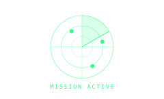
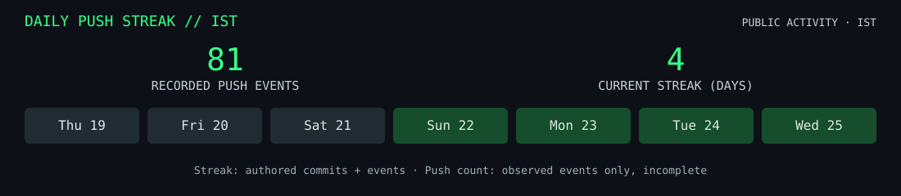

<table width="100%">
<tr>
<td width="50%" valign="top" align="center">

<h3>01 // ABOUT ME</h3>

I build Python tools, automation scripts and practical web applications while learning secure development, cybersecurity and open source with Linux and Git.

<a href="https://krushnakaale.vercel.app/">Explore my portfolio ↗</a>
</td>
<td width="50%" valign="top" align="center">

<h3>02 // CURRENT FOCUS</h3>
<!-- FOCUS:START -->

<code>● SYSTEM ONLINE</code>

<code>01 // Python automation</code>

<code>02 // Cybersecurity fundamentals</code>

<code>03 // Open-source development</code>

<!-- FOCUS:END -->
</td>
</tr>
</table>

## `03 // TECH STACK`

## `04 // LIVE GITHUB DASHBOARD`

*Verified public metrics, refreshed automatically by GitHub Actions.*

<!-- STATS:START -->

<!-- STATS:END -->

## `05 // DAILY PUSH STREAK`

*Based on observed public push days; historical coverage may be incomplete.*

## `06 // FEATURED PROJECTS`

*Selected builds worth exploring · Purple spotlight cards · Live stars, forks and project details.*

<!-- FEATURED:START -->
Available after the first profile refresh.
<!-- FEATURED:END -->

## `07 // LATEST REPOSITORIES`

*Freshest public builds first · Cyan repository cards · Automatically refreshed from GitHub.*

<!-- REPOSITORIES:START -->
Available after the first profile refresh.
<!-- REPOSITORIES:END -->

## `08 // LANGUAGE BREAKDOWN`

<!-- LANGUAGES:START -->
Available after the first profile refresh.
<!-- LANGUAGES:END -->

## `09 // PUBLIC ACTIVITY FEED`

<!-- ACTIVITY:START -->
Available after the first profile refresh.
<!-- ACTIVITY:END -->

## `10 // CONTRIBUTION SNAKE`

[View contribution activity on GitHub ↗](https://github.com/krushnakaale#js-contribution-activity)

## `11 // CONNECT WITH ME`

   

**Turning curiosity into code. Building tools that make an impact.**

---

PROFILE SYSTEM ONLINE · Powered by Python, GitHub API & GitHub Actions

